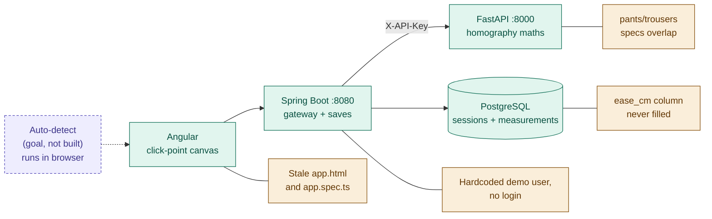
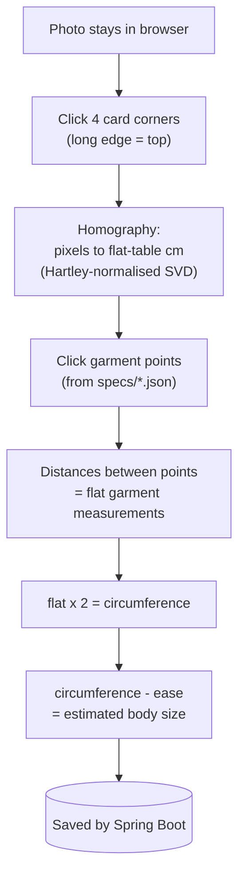
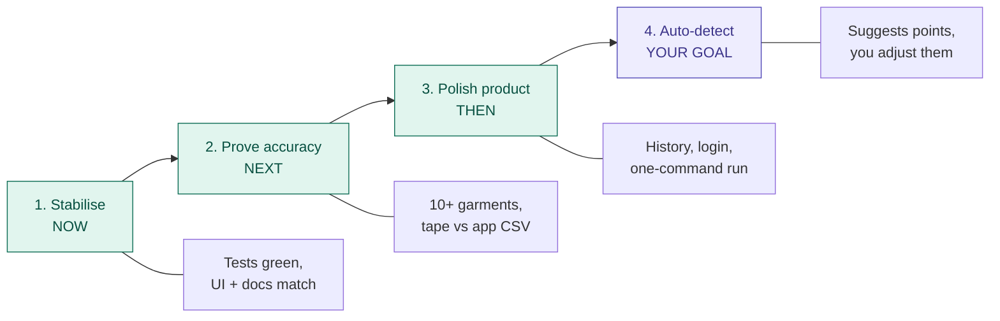
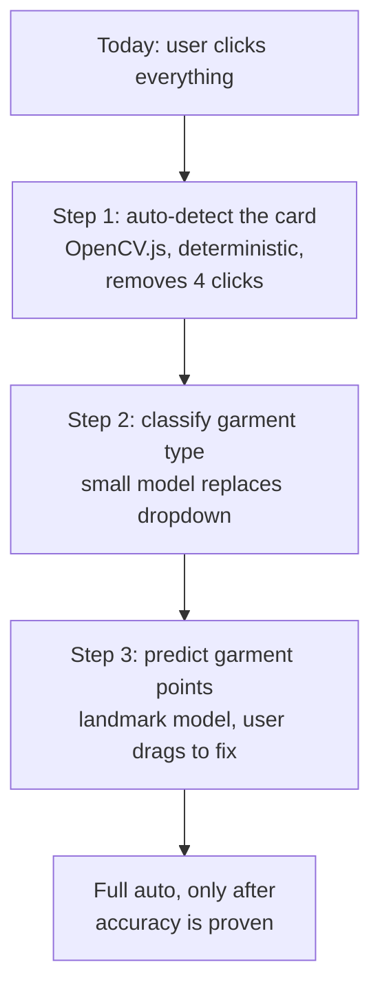

# ClothMate: Visual Plan and Status

_Snapshot: 2026-11-17. Mermaid diagrams render on GitHub and in VS Code (Markdown Preview Mermaid Support extension)._

---

## 1. Goal

Measure garments (men's and women's) from a single photo, then map them to tailor/body measurements. A bank card (8.56 x 5.40 cm) in the photo gives the scale.

| | |
|---|---|
| **Users** | Customers, tailors, staff |
| **Quality bar** | Industry-ready: secure, robust, tested |
| **Privacy rule** | The photo never leaves the browser; only (x, y) numbers are sent |
| **Scope now** | Normal-wear garments only; innerwear (and its privacy concerns) deferred to a later phase |
| **Your extension** | Upload a photo, the system detects the garment type and measures it automatically |

---

## 2. Architecture and current status



Legend: green = works today, amber = needs fixing, purple dashed = goal.

Plain-text fallback:

```
 [Auto-detect]  (goal, in-browser)
      |
      v
 Angular canvas --> Spring Boot :8080 --> FastAPI :8000
                          |
                          v
                     PostgreSQL
```

---

## 3. How one measurement is computed



---

## 4. Evidence so far

| Item | Result |
|---|---|
| Python tests | 58 pass (after restoring tests deleted by Antigravity) |
| End-to-end | Angular to Spring to FastAPI to PostgreSQL works |
| Garment specs | 16 (7 men's, 9 women's) plus `ease_defaults.json` (draft, not tailor-approved) |

Accuracy: one garment only (blue polo, tape vs app)

| Dimension | Tape (cm) | App (cm) | Error (cm) | Error (%) |
|---|---|---|---|---|
| Chest | 53.0 | 53.7 | +0.7 | 1.3 |
| Length | 72.0 | 72.7 | +0.7 | 1.0 |
| Shoulder | 48.0 | 45.8 | -2.2 | 4.6 |

**Honest reading:** one garment is not an accuracy report. The leader asked for many garment types, so this is the biggest missing deliverable. `docs/leader_update.md` currently says "Completed & Verified" and "< 1 cm error"; soften that until the table below exists.

---

## 5. Roadmap



### Phase 1: Stabilise (now)

- [ ] Run `python -m pytest` and `git status`; record exact counts
- [ ] Fix `app.spec.ts` and `app.html` (still the Angular scaffold)
- [ ] Update `request.json` (uses old `hem`; needs `hem_center`, `hem_left`, `hem_right`)
- [ ] Repair or delete `tools/measure_photo.py` (imports names that no longer exist)
- [ ] Resolve pants vs trousers spec overlap
- [ ] Make docs agree (14 vs 16 specs, 40 vs 58 tests)
- [ ] Soften claims in `docs/leader_update.md`

### Phase 2: Prove accuracy (next)

- [ ] Choose 10+ garments, men's and women's, different fabrics
- [ ] Tape-measure each; photograph each flat with card beside it, camera overhead
- [ ] Record in a CSV: garment, dimension, tape, app, error, error %
- [ ] Explain the shoulder error (seam curve vs click placement); fix the point definition if needed
- [ ] Add 1 page: error sources (card tilt, click precision, resolution, fabric stretch)

### Phase 3: Polish the product

- [ ] Session history list (`/api/sessions` into Angular)
- [ ] Real login with roles (customer / tailor / staff); remove `DEMO_USER`
- [ ] Save `ease_cm` and `user_role` in the database
- [ ] Move DB password and API key into environment variables
- [ ] Dockerise all services: one `docker compose up`
- [ ] Spring and Angular tests, GitHub Actions CI

### Phase 4: Auto-detect (your extension)



---

## 6. Where auto-detect runs (privacy deferred for now)

**Scope decision:** the focus is normal-wear clothes. Innerwear privacy is parked and will be revisited when innerwear is added. Until then it does not drive any design choice.

The browser-only rule (decision of 2026-11-11) stays as the current default because it is already built and keeps the backend simple. It is no longer a blocker, so both options are open:

| Option | Effort | Notes |
|---|---|---|
| A. In-browser models (ONNX Runtime Web / OpenCV.js) | Higher, model size limited | Matches the current architecture; start here for card detection |
| B. Server-side model (photo uploaded to the backend) | Lower, stronger models possible | Needs an upload endpoint, storage/retention rules, and leader sign-off. Also gives a path to store photos as training data |

Practical order: build card detection (Step 1) in the browser either way; decide A vs B when you reach garment-type and point prediction, based on model quality and size.

**Revisit when innerwear is added:** option B would then need explicit consent, short retention, or a return to browser-only.

Do **not** repeat threshold-based segmentation: it failed on 3 of 4 photos in the first prototype (shadows, floor contrast). Use learned models, with the homography maths as the judge of the result.

Every manual click session is also a labelled example for training. Storing photos for that purpose should be an explicit, deliberate choice.

---

## 7. Open questions for the team leader

1. Who signs off the ease values in `specs/ease_defaults.json`? (draft, not tailor-validated)
2. For normal wear, may photos be uploaded to the backend for auto-detect (and kept for training), or should detection stay in the browser?
3. Length convention: neck-shoulder point (current) vs centre of shoulder (tailor standard)
4. Can the company supply garments and photos for the accuracy test?

---

## 8. Next single step

Run `python -m pytest` and `git status`, then fix `app.spec.ts` (Angular generated test). After fixing it, explain back what `TestBed` does.
